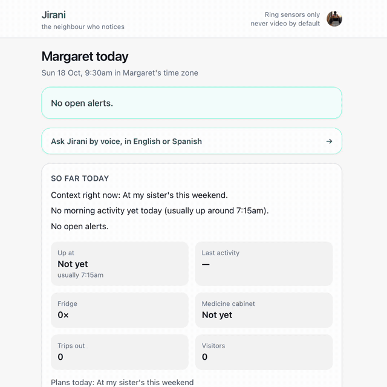
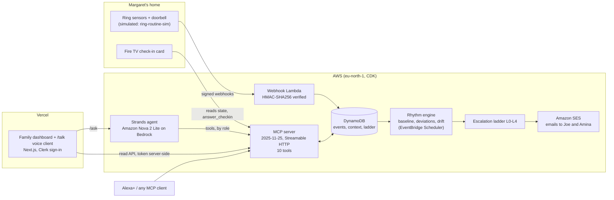

# Jirani

[](https://github.com/youneedgreg/Jirani/actions/workflows/ci.yml)
[](https://codecov.io/gh/youneedgreg/Jirani)
[](LICENSE)


**The neighbour who notices.** *Jirani* is Swahili for neighbour.

Jirani is a privacy-first caregiving agent for older adults who live alone. It learns a person's daily rhythm from Ring signals (door and contact sensors, doorbell motion and presses), never from video by default. When a day breaks pattern and nothing she told it explains why, Jirani asks **her** first, then a neighbour, then family with the evidence. A weekly report notices slow changes a timer never would.

> Statistics decide when something is off. The agent only explains it and picks the next step.

Built for the [Amazon Developer Hackathon](https://amazonappdev2026.devpost.com/) (Ring track + Alexa+ track, AWS Builder and Open Source mini challenges).

<p align="center">
  
</p>

## Why

- **63 million** Americans are family caregivers, about 1 in 4 adults ([AARP & National Alliance for Caregiving, *Caregiving in the US 2025*](https://www.aarp.org/press/releases/2025-07-24-new-report-reveals-crisis-point-for-americas-63-million-family-caregivers.html)). Many live far from the person they look after.
- **Alexa Together**, Amazon's caregiving subscription, was discontinued in May 2025; Amazon now points families to Alexa Emergency Assist ([About Amazon](https://www.aboutamazon.com/news/devices/alexa-together-launches-to-help-customers-remotely-care-for-loved-ones)).
- Timer alerts ("no activity by 10am") can't tell a lie-in or a weekend away from an emergency, and they miss changes that build up over weeks. Cameras feel like spying.

Jirani's bet: learn *her* rhythm, remember what she said, ask her before anyone else, and report slow drift in plain words.

## What it does

The demo story, end to end (`pnpm demo` plays all of it):

1. **No false alarm.** On Thursday Margaret tells Jirani she'll be at her sister's this weekend. On Sunday the house is silent, and nobody is bothered.
2. **The ladder.** Monday 10:05, no morning activity and no plan explains it. Jirani plays a soft tone on her Ring Chime (simulated), checks in with Margaret by voice and on her TV, then asks Joe next door, then tells Amina with the evidence and (with Margaret's prior consent) the front-door camera. Joe finds her in the garden; everyone gets the all-clear.
3. **Slow drift.** The weekly report notices night-time bathroom trips rising over three weeks and suggests a conversation with her doctor. It never diagnoses.
4. **She stays in charge.** "Jirani, pause for two hours."

<!-- SCREENSHOTS: Today page, Week page with the drift flag, /talk voice client, Fire TV check-in card. Added after F7a (clean demo data). -->

## Architecture



The statistics engine (`packages/core`) is pure TypeScript with no I/O and no LLM. The agent can only reach Jirani through the MCP server, with the tools allowed for whoever is speaking.

## Judge quickstart

Needs Node.js 20 or later and pnpm: run `corepack enable` (it fetches the pinned pnpm on first use), or `npm install -g pnpm` if your Node.js has no corepack.

```bash
pnpm install
pnpm demo
```

No AWS account, Ring device or API keys needed. The demo starts the real server, replays four weeks of signed Ring-shaped events through the real webhook (HMAC-verified), and drives the real MCP server over Streamable HTTP with an MCP client, the way an Alexa+ experience would.

- **Tests:** `pnpm test` (113 tests: the six roadmap scenarios, ladder, drift statistics, webhook, Ring client and chime, MCP, agent wiring, CDK stack). 17 of them need DynamoDB Local and are skipped without it: run `pnpm ddb:local` and set `DYNAMODB_ENDPOINT=http://localhost:8000`. `pnpm coverage` measures `packages/` and `services/` together, and CI uploads it to Codecov (the badge above). Codecov's percentage is lower than vitest's line count because it counts a partly covered branch as a miss.
- **Deploy your own:** `pnpm aws:deploy` (see [docs/aws.md](docs/aws.md)).
- **Live family dashboard:** [jiraniamazon.vercel.app](https://jiraniamazon.vercel.app) is invite-only, because it shows household data and each spoken question is a paid Amazon Nova call. The video shows it.

## How it decides

| Situation | Signal | Default threshold |
| --- | --- | --- |
| No morning activity | Nothing but a lone bathroom trip after 5am | Later than her median wake time + max(2.5 robust SD, 45 min) |
| Usual thing missing | Fridge or medicine cabinet not opened after getting up | Typical delay + max(3 robust SD, 60 min); low severity, logged only |
| Unusual event | Door or doorbell at an hour seen on under 4% of days | Front door / doorbell at night is high severity |
| Long stillness | No activity at home during waking hours | max(1.25 × her 95th-percentile quiet spell, 3 h); not after leaving by the front door |
| Slow drift | Last 7 lived-in days vs up to 21 days ending a week earlier (a guard week, so a slow rise isn't its own baseline); only days she was home for the morning count | ≥ 2.5 standard errors **and** a practical change (e.g. +1 night trip) |

Context Margaret or Amina gives (`away`, `late_start`, `visitor_expected`) suppresses or shifts these, and every suppression keeps its reason so `why_alert` can explain it. A sensor that goes offline is a maintenance notice, never an emergency. Days she was away are never learned as "normal". If late events show she was fine after all, the alert closes itself and says so.

**Measured on simulated households** (`packages/core/test/scenarios.test.ts`, 40 seeds): the weekly report caught a three-week rise in night trips in 31 of 40 households, and flagged 0 of 40 steady routines.

## The escalation ladder

| Level | Who | Waits |
| --- | --- | --- |
| 0 | Logged only (small deviations) | n/a |
| 1 | Margaret: a soft Ring Chime tone (simulated), then a voice check-in + Fire TV card | 20 min |
| 2 | Neighbour: "Could you knock?" | 20 min |
| 3 | Family, with the evidence; live view only if Margaret consented | family decides |
| 4 | Suggest calling 911 with a summary ready | a human decides; Jirani never calls |

## Surfaces

### Family dashboard and voice client

[youneedgreg/ring-api-helloworld](https://github.com/youneedgreg/ring-api-helloworld) (Next.js, on Vercel, Clerk sign-in with invite-only sign-up). Amina's phone-first view: **Today** (her day in plain words and a timeline), **Alerts** (every step of the ladder with times), **Week** (the drift report and four 4-week charts), **Messages** and **Plans**. **`/talk`** is a voice client for Margaret or family, in English or Spanish, that shows which MCP tools the agent called. **Front door** (`/live/front-door`, linked from an open Level 3 alert) opens the Ring live view only during a Level 3+ alert and only with Margaret's prior consent; without a Ring token, as on the public site, it plays a labelled replay of the Ring Developer Playground's simulated stream. The Jirani API token and the Ring token stay on the server.

### Fire TV check-in card

[youneedgreg/react-native-multi-tv-app-sample](https://github.com/youneedgreg/react-native-multi-tv-app-sample). A check-in card over whatever Margaret is watching: "I'm OK" resolves the alert, "Call Amina" asks family to call her (`answer_checkin` with `call_family`). English or Spanish, in the Expo app and the Vega app; it runs on the Vega Virtual Device (Vega SDK 0.24).

### MCP server (Alexa+ track)

Spec **2025-11-25**, **Streamable HTTP**, stateless (`POST /mcp`). Run it with `pnpm mcp`; the deployed one is checked with the MCP Inspector.

| Tool | For | What it does |
| --- | --- | --- |
| `tell_jirani` | Margaret, Amina | Save a plan with start/end ("at my sister's Saturday") |
| `list_plans` | Margaret, Amina | Current and upcoming plans, with ids |
| `cancel_plan` | Margaret, Amina | Remove a plan that was saved wrongly or is off |
| `answer_checkin` | Margaret, Joe | Resolve or escalate the open alert; Margaret can also ask family to call her (`call_family`, the TV card's second button) |
| `pause_monitoring` | Margaret | Pause for N hours; family sees *that* it's paused, not why |
| `how_is_she` | Amina | Today in plain words, from real events |
| `why_alert` | Amina | Which expectation broke, by how much, what context was checked, who was asked when |
| `weekly_report` | Amina | The drift report |
| `view_front_door` | Amina | Ring live view, only at Level 3+ and only with consent |
| `usual_routine` | anyone | The learned baseline in plain words |

### The agent (Amazon Nova on Bedrock)

A [Strands](https://strandsagents.com) agent on Amazon Bedrock (Amazon Nova 2 Lite, EU inference profile, temperature 0) answers Margaret and Amina in a sentence or two, in English or Spanish (`lang: "es"`). It can only reach Jirani through the MCP server above, and only with the tools allowed for whoever is speaking: Margaret's pause control isn't available to family, and the front-door camera isn't a tool on her side. It must cite what the tools returned, say "I don't know" otherwise, and never diagnose.

```bash
pnpm ask "How's Mum this week?"                       # needs AWS credentials with Bedrock access
pnpm ask --as resident "I'm at my sister's Saturday"
pnpm ask --lang es "¿Cómo está mamá hoy?"
```

## Built during the hackathon

- **This repository** was started for the hackathon (first commit 15 Oct 2026): the rhythm engine, Ring client and webhook verification, simulator, MCP server, agent, AWS stack and tests.
- **The family dashboard** is a fork of Amazon's [`ring-api-helloworld`](https://github.com/AmazonAppDev/ring-api-helloworld). Amazon's live-view sample is kept at `/sample`; the family pages, the `/talk` voice client and Clerk sign-in are ours (15 commits on top of the sample's 12, as of 20 Oct).
- **The TV card** is added to Amazon's [`react-native-multi-tv-app-sample`](https://github.com/AmazonAppDev/react-native-multi-tv-app-sample); the TV app shell is Amazon's.
- **[`ring-routine-sim`](https://github.com/youneedgreg/ring-routine-sim)** is new and open source (MIT), published on npm as [`ring-routine-sim`](https://www.npmjs.com/package/ring-routine-sim): weeks of Ring-shaped household events with drift injection and HMAC-signed replay.

## How Jirani compares

| | Jirani | [ring-vision-mcp](https://github.com/SwaggyXO/ring-vision-mcp) | [ring-sandbox](https://github.com/josepha-mayo/ring-sandbox) |
| --- | --- | --- | --- |
| What it is | A care agent: learns a routine, decides when to worry, escalates | An MCP server over the Ring Partner API | A Python client and offline emulator of the Ring Partner API |
| MCP tools are about | Margaret's day: plans, check-ins, alerts, drift | Devices: inventory, status, event history, live video | n/a (Python API) |
| Video | Off by default; live view only at Level 3 with consent | Live video is a core tool | Media endpoints emulated |
| Who decides | Statistics; the LLM only explains | The calling assistant | n/a |
| Test data | `ring-routine-sim`: weeks of one household's routine with slow drift | Mock mode | Short scripted scenarios (a delivery, a home aide visit), pytest fixtures |

They fit together: an assistant could use ring-vision-mcp for the cameras and Jirani for "is she OK?", and ring-sandbox and ring-routine-sim cover different kinds of test data.

## Repository

```
packages/core              rhythm baseline, deviations, context, escalation ladder, drift report (pure TS, no I/O)
packages/ring              Ring Partner API client, webhook schemas, HMAC-SHA256 verification
services/webhook           framework-agnostic Ring webhook handler (Express locally, Lambda in AWS)
services/mcp               MCP server, dashboard API, local runtime, the demo
services/agent             Strands agent on Amazon Nova (Bedrock) that answers through the MCP server
services/aws               DynamoDB store + Lambda handlers (webhook, MCP/API, agent, scheduled evaluation, email)
infra/                     AWS CDK app: DynamoDB, Lambda + Function URLs, Bedrock access, EventBridge Scheduler, SES, Secrets Manager
docs/                      aws.md, feedback.md, friction-log.md
```

The event simulator isn't in this repo: Jirani installs [`ring-routine-sim`](https://www.npmjs.com/package/ring-routine-sim) from npm (pinned at 0.1.0), and its code and tests live in [its own repo](https://github.com/youneedgreg/ring-routine-sim).

| Command | What it does |
| --- | --- |
| `pnpm demo` | The whole story end to end |
| `pnpm test` / `pnpm coverage` | All tests / with coverage |
| `pnpm ask "<question>"` | Ask the agent (`--as resident` for Margaret's side, `--lang es` for Spanish) |
| `pnpm ddb:local` + `pnpm test:aws` | DynamoDB store and the Lambda handlers, end to end on DynamoDB Local |
| `pnpm aws:deploy` / `pnpm aws:destroy` | Deploy to / remove from your AWS account (see [docs/aws.md](docs/aws.md)) |
| `pnpm aws:story <thursday --plan\|sunday\|monday\|tuesday\|all>` | Play the demo story against the deployed stack, step by step (`--local` for `pnpm mcp`; see [docs/aws.md](docs/aws.md)) |
| `pnpm mcp` | Local server: `/mcp`, `/ring/webhook`, the dashboard's read API `/api/state`, `/api/report`, `/api/timeline`, `/api/days`, and the agent at `POST /ask` (calls Amazon Nova with your AWS credentials) |
| `JIRANI_ALLOWED_HOSTS=10.0.2.2 JIRANI_CORS_ORIGINS=http://localhost:8082 pnpm mcp` | Same, reachable from an Android TV emulator and from the TV card's web build |
| `pnpm sim presets` | List simulated households |
| `pnpm sim generate --preset demo --out data/demo.ndjson` | Generate events |
| `pnpm sim replay --file data/demo.ndjson --url http://localhost:3333/ring/webhook --key dev-only-change-me` | Replay them, signed |

## Status

**Live and tested:** the rhythm engine, HMAC-verified Ring webhooks (1,024 signed events in Ring's documented v1.1 payload accepted on AWS, 0 rejected), the MCP server (called from the MCP Inspector against AWS), the Strands agent on Amazon Nova (English and Spanish), the AWS stack (DynamoDB, Lambda with Function URLs, EventBridge Scheduler, SES, Secrets Manager), real emails through SES, the family dashboard and voice client on Vercel behind Clerk sign-in, and the TV card against a local Jirani on the Vega Virtual Device ("I'm OK" resolves the alert) and on the web build (both buttons).

**Ring API:** the Ring client was run against the real Ring API with a Ring Developer Playground token: devices (with `?include=`), status, capabilities, event history and the user endpoint all answered as expected. The dashboard's live view (WHEP) was run against the Playground too: the simulated stream played at 1280×720, closed itself before Ring's 30-second limit, and Ring confirmed each close.

**Not yet:** the public site shows the front door as a labelled replay, because Ring Developer Playground tokens last only 30 minutes.

**Ring data honesty:** the Ring Developer Playground provides simulated live-view streams but no motion, doorbell or sensor events, so event data in this repo comes from `ring-routine-sim`, in Ring's documented webhook v1.1 payload (event name in `data.type`, device in `attributes.source`, epoch-millisecond timestamps), signed exactly like Ring signs webhooks. Contact-sensor events use Ring's names, `contact_sensor_faulted` (opened) and `contact_sensor_cleared` (closed); Ring marks sensor support as Early Access, so they may still change.

**Ring Chime: not tried on a real Chime.** Level 1 starts with a soft tone on Margaret's Chime, and the Ring client implements Ring's documented recipe for it (status, then the slot's `audio_ref` from configurations, then `POST /v1/devices/{id}/media/audio/playback`), skipping a chime that is offline or that she has snoozed. Without a real Chime that call is unreachable rather than merely unverified (the Playground has none), and Chime Controls is Early Access, so it is tested only against Ring's documented example responses (`packages/ring/test/chime.test.ts`). Nothing calls it at runtime: the demo, the dashboard's Messages page and `why_alert` all say "simulated: no real Chime is linked".

**Not a medical device.** Jirani describes changes in routine and suggests conversations. It does not diagnose anything and never contacts emergency services itself.

## License

MIT. See [LICENSE](LICENSE).
